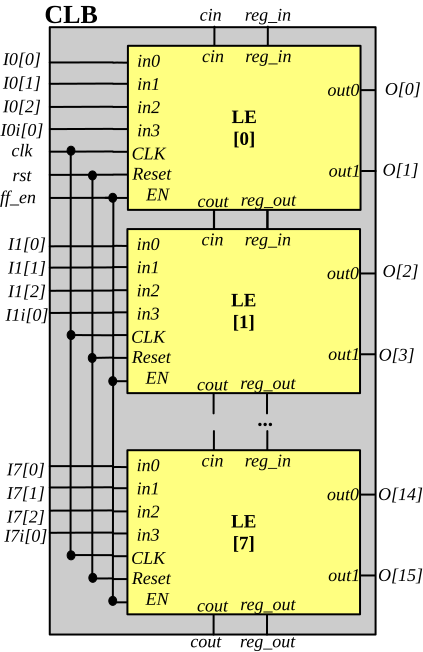
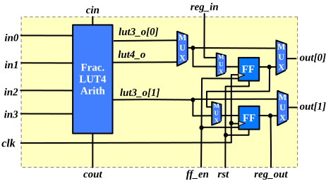
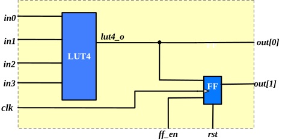
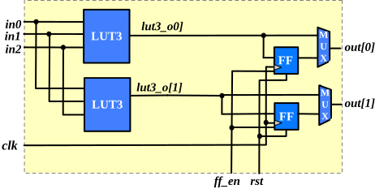
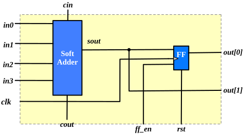
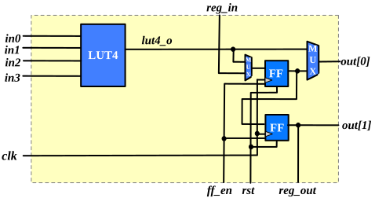

.. _datasheet_mosofa_clb:

Configurable Logic Block
------------------------

Each *Configurable Logic Block* (CLB) consists of 8 *Fracturable Logic Elements* (FLEs) as shown in :numref:`fig_mosofa_clb_arch`.
All the pins of the FLEs are directly wired to CLB pins without a local routing architecture.
Feedback connections between FLEs are implemented by the routing architecture outside the CLBs.
Detailed description of FLE architecture is shown in the rest of the section.

.. _fig_mosofa_clb_arch:

  Configurable logic block schematic

.. _datasheet_clb_fle_schematci:

FLE Schematic
~~~~~~~~~~~~~

As shown in :numref:`fig_mosofa_fle_schematic`, each *Fracturable Logic Element* (LE) consists of

- a fracturable 4-input Look-Up Table (LUT)
- two D-type fracturable Flip-Flops (FF)
- a 1-bit soft adder

.. _fig_mosofa_fle_schematic:

  Detailed schematic of a logic element

The FLE can operate in different modes to map logic function efficiently

- 4-input LUT and single FF (see details in :ref:`datasheet_clb_fle_n1_lut4`).
- Dual 3-input LUTs and two FFs (see details in :ref:`datasheet_clb_fle_n2_lut3`).
- 1-bit adder and single FF (see details in :ref:`datasheet_clb_fle_arith`).
- 4-input LUT and two shift registers (see details in :ref:`datasheet_clb_fle_sreg`).

In each mode, a FF can be mapped into various operating modes.
The FF has a ``EN`` signal to control write enable.
The following table summarizes the 16 supported flip-flop configurations.

.. list-table::
   :header-rows: 1
   :widths: 12 16 16 16 20

   * - Clock Edge
     - Control
     - Synchronization
     - Polarity
     - Mode
   * - Rising
     - Set
     - Synchronous
     - Active-High
     - ``sdffs``
   * - Rising
     - Set
     - Synchronous
     - Active-Low
     - ``sdffsn``
   * - Rising
     - Set
     - Asynchronous
     - Active-High
     - ``dffs``
   * - Rising
     - Set
     - Asynchronous
     - Active-Low
     - ``dffsn``
   * - Rising
     - Reset
     - Synchronous
     - Active-High
     - ``sdffr``
   * - Rising
     - Reset
     - Synchronous
     - Active-Low
     - ``sdffrn``
   * - Rising
     - Reset
     - Asynchronous
     - Active-High
     - ``dffr``
   * - Rising
     - Reset
     - Asynchronous
     - Active-Low
     - ``dffrn``
   * - Falling
     - Set
     - Synchronous
     - Active-High
     - ``sdffns``
   * - Falling
     - Set
     - Synchronous
     - Active-Low
     - ``sdffnsn``
   * - Falling
     - Set
     - Asynchronous
     - Active-High
     - ``dffns``
   * - Falling
     - Set
     - Asynchronous
     - Active-Low
     - ``dffnsn``
   * - Falling
     - Reset
     - Synchronous
     - Active-High
     - ``sdffnr``
   * - Falling
     - Reset
     - Synchronous
     - Active-Low
     - ``sdffnrn``
   * - Falling
     - Reset
     - Asynchronous
     - Active-High
     - ``dffnr``
   * - Falling
     - Reset
     - Asynchronous
     - Active-Low
     - ``dffnrn``

.. _datasheet_clb_arch_fle_n1_lut4:

FLE LUT4 Mode
~~~~~~~~~~~~~

The logic element can operate in the Look-Up Table (LUT) + Flip-flop (FF) mode as many classical FPGA logic elements.
As depicted in :numref:`fig_mosofa_fle_mode_n1_lut4`, the fracturable LUT will operate as a single-output 4-input LUT and the lower FF is used to implemented sequential logic.

The operating mode is designed to efficiently implement 4-input functions with registerable outputs. 

.. _fig_mosofa_fle_mode_n1_lut4:

  FLE operating mode: LUT4 + FF

.. _datasheet_clb_fle_n2_lut3:

FLE Dual-LUT3 Mode
~~~~~~~~~~~~~~~~~~

The logic element can operate in the dual Look-Up Tables (LUTs) and Flip-flops (FFs) mode as many modern FPGA logic elements.
As depicted in :numref:`fig_mosofa_fle_mode_n2_lut3`, the fracturable LUT will operate as two 3-input LUTs with shared inputs.

The operating mode is designed to efficiently implement two 3-input functions with shared input variables.

.. _fig_mosofa_fle_mode_n2_lut3:

  FLE Operating mode: dual LUT3 + FFs

.. _datasheet_clb_fle_arith:

FLE Adder Mode
~~~~~~~~~~~~~~

The logic element can operate in the arithmetic mode as many modern FPGA logic elements.
As depicted in :numref:`fig_mosofa_fle_mode_ale`, the fracturable LUT will operate as 1 adder with registers at output.

The operating mode is designed to efficiently implement 1-bit adder function with shared input variables.

.. _fig_mosofa_fle_mode_ale:

  FLE Operating mode: 1-bit adder + FF

.. _datasheet_clb_fle_shiftreg:

FLE Shift Register Mode
~~~~~~~~~~~~~~~~~~~~~~~

The logic element can operate in the shift register mode as many modern FPGA logic elements.
As depicted in :numref:`fig_mosofa_fle_mode_sreg`, the fracturable LUT will operate as LUT4 and two shift registers.
In this operating mode, when the LUT4 is mapped to generate the input data for the shift register chain, the ``reg_in`` port will be disabled. The FLE is the head of a shift register chain.
Alternatively, when the ``reg_in`` port is selected, the LUT4 is not mapped and the two shift registers are used.

.. _fig_mosofa_fle_mode_sreg:

  FLE Operating mode: LUT4 + Shift registers
