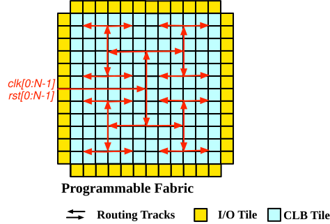

.. _datasheet_mosofa_clock:

Clock Architecture
==================

Clock and reset ports locate at the left side of the eFPGA fabric.
Depending on the actual array size of the eFPGA fabric, the exact location of clock and reset ports are different but will be close to the middle point of the left side.
After entering the fabric, all the clock and reset signals will be distributed through a H-tree network and reach each tile, as depicted in :numref:`fig_mosofa_clk_arch`

.. _fig_mosofa_clk_arch:

  Clock architecture including reset signals

