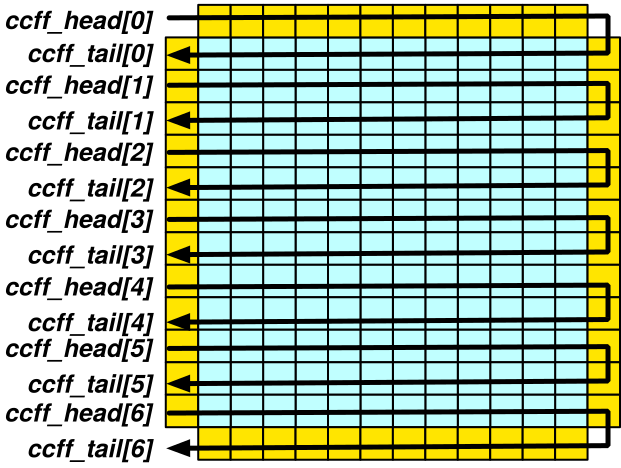

.. _datasheet_mosofa_config:

Configuration User Guide
========================

The eFPGA employs the configuration chains to load bitstreams.
As depicted in :numref:`fig_mosofa_ccff`, where the eFPGA is sized to an array of 12x12, there are multiple configuration chains across the fabric.
All the chains follows a row-based organization, starting from the left side and ends at the left side.
Each chain is controlled by an independent clock and can be reloaded separatedly.
All the chains share the same reset signals. 

.. _fig_mosofa_ccff:

  Configuration protocol and detailed architecture
