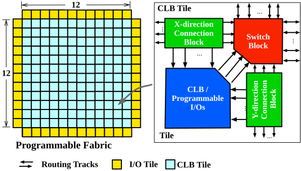
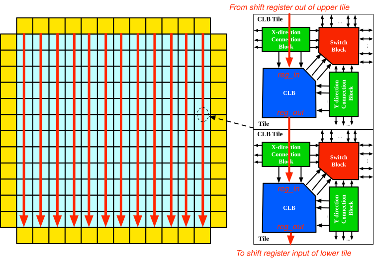

.. _datasheet_mosofa_efpga:

eFPGA Architecture
------------------

.. _datasheet_mosofa_efpga_arch_floorplan:

Floorplan
^^^^^^^^^

:numref:`fig_efpga_arch` shows an example on the architecture of the embedded FPGA fabric, which is sized to a 12x12 array.
The eFPGA follows a homogeneous architecture which only contains two type of tiles: 

- Configurable Logic Block (CLB) at the center (See detailed architecture in :ref:`datasheet_mosofa_clb`)
- Programmable I/O at the boundary (See detailed architecture in :ref:`datasheet_mosofa_io`)

.. _fig_mosofa_efpga_arch:

  Tile-based eFPGA architecture

.. _datasheet_mosofa_efpga_arch_tiles:

Tiles
^^^^^

The FPGA architecture follows a tile-based organization, to exploit the fine-grainularity in physical design, where the following types of tiles are built:

.. list-table:: FPGA tile type and functionalities
  :widths: 15 15 70
  :header-rows: 1
  :class: longtable
  
  * - Type
    - Description
  * - CLB
    - Each CLB tile consists of
        * a Configurable Logic Block (CLB)          
        * a X-direction Connection Block (CBx)       
        * a Y-direction Connection Block (CBy)      
        * a Switch Block (SB)                      
  * - IO North
    - Each I/O tile consists of
        * a programmable I/O bank          
        * a Y-direction Connection Block (CBy)      
        * a Switch Block (SB)                      
  * - IO East
    - Each I/O tile consists of
        * a programmable I/O bank          
        * a X-direction Connection Block (CBx)       
        * a Switch Block (SB)                      
  * - IO South
    - Each I/O tile consists of 
        * a programmable I/O bank          
        * a X-direction Connection Block (CBx)       
        * a Y-direction Connection Block (CBy)      
        * a Switch Block (SB)                      
  * - IO West
    - Each I/O tile consists of
        * a programmable I/O bank          
        * a X-direction Connection Block (CBx)       
        * a Y-direction Connection Block (CBy)      
        * a Switch Block (SB)                      

.. _datasheet_mosofa_efpga_routing_arch:

Routing Architecture
^^^^^^^^^^^^^^^^^^^^

The routing architecture is based on uni-directional routing tracks, which are interconnected by routing multiplexers.
:numref:`fig_mosofa_efpga_routing_arch` illustrates the detailed organization of the routing architecture.

.. _fig_mosofa_efpga_routing_arch:

.. figure:: ./figures/mosofa_efpga_routing_arch.svg
  :width: 80%
  :alt: Detailed routing architecture

  Detailed routing architecture

The routing architecture consists the following type of routing tracks:

- Length-1 wires (``L1 wires``), which hop over 1 logic block (including I/O block)
- Length-2 wires (``L2 wires``), which hop over 2 logic block (including I/O block)
- Length-4 wires (``L4 wires``), which hop over 4 logic block (including I/O block)

Each tile includes two routing channels, i.e., the X-direction routing channel and the Y-direction routing channel, providing horizental and vertical connections to adjacent tiles.
Each routing channel consists of 96 pairs of routing tracks. See details in :numref:`table_datasheet_efpga_arch_routing_track_distribution`.

.. _table_datasheet_efpga_arch_routing_track_distribution:

.. list-table:: Routing track distribution of eFPGA 
  :widths: 30 70
  :header-rows: 1
  :class: longtable

  * - Track type
    - Number of tracks per channel
  * - Length-1
    - 24 (25%)
  * - Length-2
    - 24 (25%)
  * - Length-4
    - 48 (50%)
  * - Total
    - 96

.. _datasheet_mosofa_efpga_clock_network:

Clock Network
^^^^^^^^^^^^^

Each tile can be driven by a number of clocks and resets
In each tile, there are routing multiplexers to select from clocks and resets to drive each Flip-Flop.
The clocks and resets enter the eFPGA at center point of the left side and span across the fabric in a H-tree style.
See details in :ref:`datasheet_mosofa_clock`

.. _datasheet_mosofa_efpga_carry_chains:

Carry Chains
^^^^^^^^^^^^

The carry chains can span across tiles in the same column.
:numref:`fig_efpga_carry_chain` illustrates the detailed carry chain connections across tiles.
For chain connection across columns, global routing has to be used.

.. _fig_mosofa_efpga_carry_chain:

  Detailed carry chains across tiles

.. _datasheet_mosofa_efpga_shift_register_chains:

Shift Register Chains
^^^^^^^^^^^^^^^^^^^^^

The shift register chains can span across tiles in the same column.
:numref:`fig_mosofa_efpga_shiftreg_chain` illustrates the detailed shift register chain connections across tiles.
For chain connection across columns, global routing has to be used.

.. _fig_mosofa_efpga_shiftreg_chain:

  Detailed shift register chains across tiles

.. _datasheet_mosofa_efpga_config:

Configuration Protocol
^^^^^^^^^^^^^^^^^^^^^^

The eFPGA adapt configuration chains to load bitstreams.
A number of configuration chains connect tiles across the complete eFPGA. 
All the configuration chains start from the left side and end at the right side.
Each configuration chain is controlled by an independent clock for reconfiguration.
See details in :ref:`datasheet_mosofa_config`

