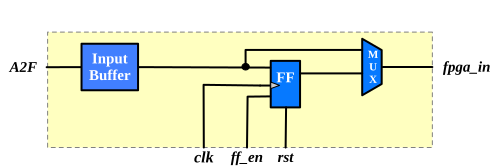
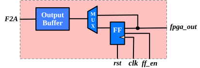

.. _datasheet_mosofa_io:

I/O Banks
=========

Each I/O tile consists of 

- an I/O bank
- two connection blocks
- a switch block

Each I/O bank contains a number of programmable inputs and programmable outputs, as shown in :numref:`fig_mosofa_pinput` and :numref:`fig_mosofa_poutput` respectively.

The number of programmable inputs and programmable outputs can be configured by the command ``set_io_num``

Input signals arrive at the inputs of I/O banks, pass through programming inputs and enter eFPGA fabric through switch blocks.

Output signals arrive at the connection blocks, pass through programming outputs and exit eFPGA fabric through the outputs of I/O banks.

Programmable Input
------------------

In a programmable input, signal propagated from ``F2A`` (FPGA-to-ASIC) to ``fpga_in``.
Each programmable input can be configured in combinational or sequential modes.

.. _fig_mosofa_pinput:

  programmable input architecture

Programmable Output
-------------------

In a programmable output, signal propagated from ``fpga_out`` to ``A2F`` (ASIC-to-FPGA)
Each programmable output can be configured in combinational or sequential modes.

.. _fig_mosofa_poutput:

  programmable output architecture

