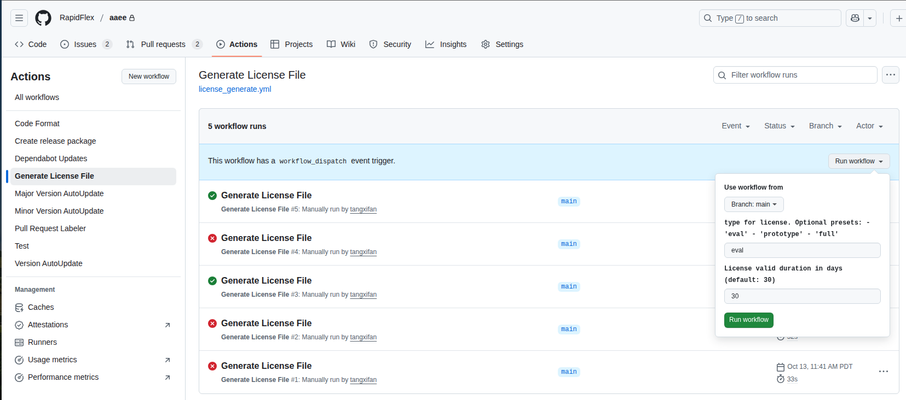
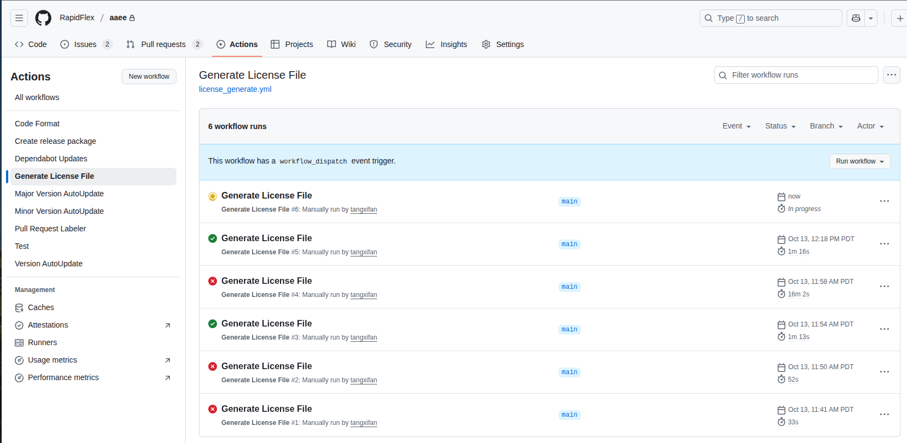
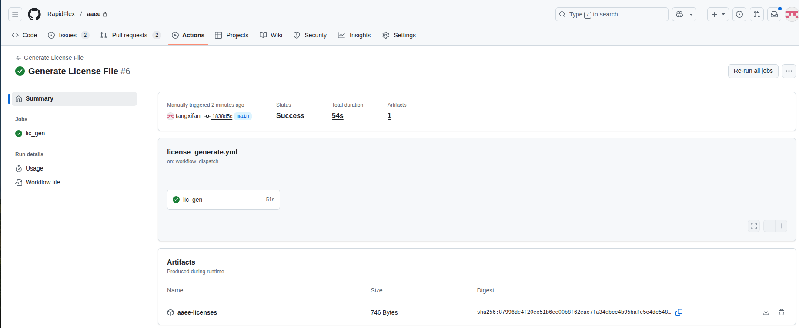
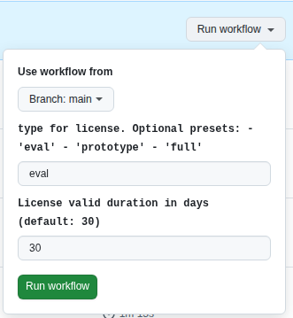

.. _developer_lic_gen:

Issue Licenses
==============

Licenses is to ensure that ArkAngel is distributed to customer legally
For each customer, a dedicated license may be issued.
There are two ways to generate the license:

- Through the web protocol from Github (**recommended**)
- Through command-line options (For special license only)

.. _developer_lic_gen_license_type:

License Types
-------------

Depending on the type of the issued license, you may access to the following features:

- ``evaluation``: enable full-features in architecture development, architecture evaluation
- ``prototyping``: include all the features in ``evaluation``, and enable full-features in netlist development, design verification
- ``full``: include all the features in ``prototyping``, and enable full features in physical design and sign-off

.. _developer_lic_gen_trail_license:

Generate Trail License
----------------------

Web Protocol
````````````

.. note:: This is the recommended way to generate license for Redhat/CentOS 7.9.

- Login to the Github of ``aaee`` repository
- Go to the tab ``Actions`` and select the ``Generate License File`` workflow.
- Click the ``Run workflow`` button to show the pull-down menu. You will see an web protocol as shown in :numref:`fig_licgen_web_interface`
- For a trail license, you may take the default settings and click the ``Run workflow`` button, and the license generation is triggered
- You may refresh the webpage and see a new workflow is initiated, as shown in :numref:`fig_licgen_web_triggered`
- Wait until the workflow is finished. If any errors occurred, please contact maintainers. 
- After the workflow is completed without errors. Click the new workflow and the license files can be downloaded through artifacts, as shown in :numref:`fig_licgen_web_interface`

.. _fig_licgen_web_interface:



  License generation through web interface

.. _fig_licgen_web_triggered:



  License generation triggered through web interface

.. _fig_licgen_web_artifacts:



  License download through web interface artifacts

Command-line Interface
``````````````````````

License can be generated through make command with various options. This is applicable to both CentOS/Redhat 7.9 and Ubunut 22.04

- Get the license generator package. For ubuntu 22.04, you may download from the artifacts where the customer release workflow runs.

- Follow the guidelines below

.. literalinclude:: lic_gen_readme.md
  :language: markdown

The output license file can be found under ``./lic_files/aaee_eval30days.lic``
The MD5 assoicated to the license file can be found under ``./lic_files/aaee_eval30days.lic.md5``

Generate Custom License
-----------------------

Web Protocol
````````````

Follow the procedures in :ref:`developer_lic_gen_trail_license`.

.. note:: Refer to :ref:`developer_lic_gen_license_type` when selecting the license type. Regarding duration of the license, please confirm with the requester on the license.

- Before triggering the workflow, edit the options available in the pull-down menu
- Trigger the workflow

.. _fig_licgen_web_options:



  License generation options through web interface

Command-line Interface
``````````````````````

.. note:: The output license file name is in the format of ``aaee_<SELECTED_TYPE><SELECTED_DURATION>days.lic``, e.g., aaee_eval60days.lic

To change the duration of the license, you may try 

.. code-block::

  # Ensure you are at the AAEE project home
  # This will generate a license valid for 90 days
  make license LIC_DURATION=90

To change the type of the license, you may try

.. code-block::

  # Ensure you are at the AAEE project home
  # This will generate a license valid for 90 days in the type of full
  make license LIC_DURATION=90 LIC_TYPE=full

Validate License
----------------

To ensure the generated license is valid, a quick test should be run

.. code-block::

  # Ensure you are at the AAEE project home
  # Assume you are in bash shell here. If not, adapt the following line to your context
  export ARKANGEL_LICENSE_PATH=./lic_files/aaee_full60days.lic
  ./build/liblicensemanager/test_lic

Release License
---------------

Both the license file and its MD5 file should be sent to customer together
