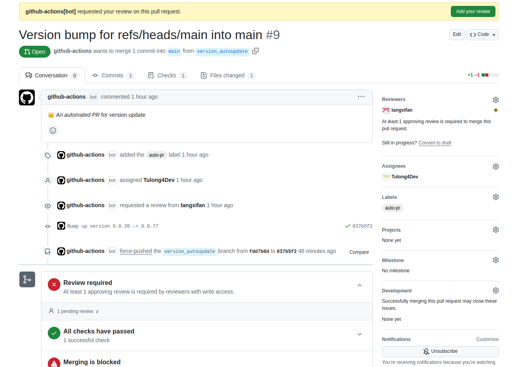
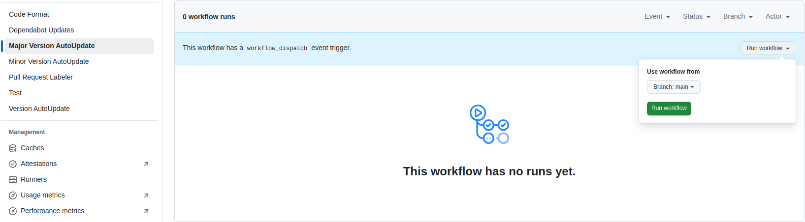
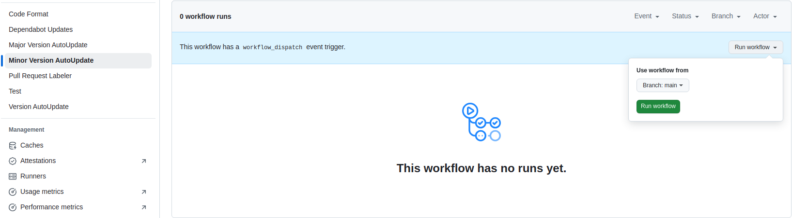
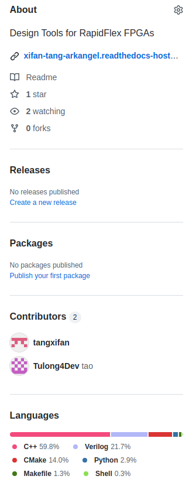

.. _developer_release_proc:

Release procedures
==================

When maintainers agree to release a new version, please follow the steps to ensure a clean release.

- Refer to version rules in :ref:`developer_version_number`.
- Check if the major and minor version is expected. If not, run the dedicated CI. See details in :ref:`developer_release_proc_ci`
- Create a release by using the Github webpage. See details in :ref:`developer_release_proc_web`

.. _developer_release_proc_ci:

Version Auto-Update
-------------------

The patch count of the version number is automatically calculated.
Each time a pull request is merged to the main branch, an auto-update on the patch number is triggered.
A resulting PR is automatically created and request for review.
Please merge it right after to keep clean version tracking.
See :numref:`fig_version_update_ci_patch` as an example

.. _fig_version_update_ci_patch:

  Automatic PR created for patch number update

The minor version and major version are also automically updated through CI. Different than the patch count, the CI has to be triggered manually. See :numref:`fig_major_version_update_ci_run` and :numref:`fig_minor_version_update_ci_run` as an example

.. _fig_major_version_update_ci_run:

  Run major version auto-update using CI flow

.. _fig_minor_version_update_ci_run:

  Run minor version auto-update using CI flow

.. _developer_release_proc_web:

Release Creation
----------------

Prepare your release notes. Include the following criteria

  - Impacts: State the impacts on users
  - Status: Provide the current status of core functions, regression tests etc.
  - Detail changes: A list of detailed code changes (only milestones are considered)
  - Effort count: Count the number patches since last release

You may refer to previous release notes as a baseline to start with.

.. _fig_make_release_ui:

  Create release using Github webpage. Click the button ``make release``

.. note::

   When running ``make release``, you need to pay attention to the trigger rules. For example:

   - When the tag name is ``v1.0.0``, the build triggered is the internal engineering version, which does **not** require a license.
   - When the tag name is ``v1.0.0-license``, the build triggered is the customer-facing version, which **requires** a license.
