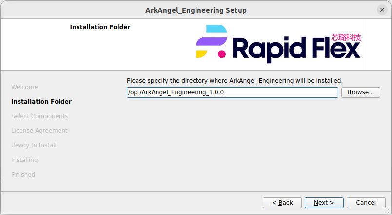

.. _manual_install:

How to Install
--------------

.. note:: Before start, please ensure all the dependencies are installed on your system. See details in :ref:`manual_dependency`

.. note:: Please prepare 6GB disk space to install ArcXpress Engineering Edition

Run Installer
~~~~~~~~~~~~~

Get your installer and place it to a location. For example, 

.. code-block:: shell

  ~/rapidflex_aaee/ArcXpress_Engineering-1.0.0-Linux.run

To start the installation process, you may choose to 

- double click the file
- or run the command 

.. code-block:: shell

  cd ~/rapidflex_aaee/
  ./ArcXpress_Engineering-1.0.0-Linux.run

.. warning:: You have to modify the installation folder as the default one contains a space

:numref:`fig_aaee_install_path`` is an example how you can modify the installation folder

.. _fig_aaee_install_path:

Follow the installer guidelines to accomplish the installation process. 

Setup License
~~~~~~~~~~~~~

Before launching ArcXpress, the license path should be properly set up.

.. note:: Ensure you receive a valid license from RapidFlex team! Place your license file and its MD5 in a secured location and under the same directory

If you are in bash shell, you may try

.. code-block::

  # Ensure the MD5 file of the license is under the same directory of your license file!!!
  export ARKANGEL_LICENSE_PATH=<path_to_your_license_file>

If you are in C shell, you may try

.. code-block::

  setenv ARKANGEL_LICENSE_PATH=<path_to_your_license_file>

Launch ArcXpress
~~~~~~~~~~~~~~~

To launch ArcXpress, the envoirnment variable should be properly set up.

.. code-block::

  # This is the example for bash
  export PATH=$PATH:/opt/ArcXpress_Engineering_1.0.0/bin

.. code-block::

  # This is the example for csh
  setenv PATH $PATH:/opt/ArcXpress_Engineering_1.0.0/bin

.. note:: You may add the setup to your shell init script. Such as ~/.bashrc and ~/.cshrc

.. warning:: Please do **NOT** switch to any shell or window after setup, unless add the env variable to your shell init script. 

After the setup, you can launch ArcXpress by 

.. code-block::

  # Enter interactive mode
  aaee -i

Or you can run batch mode by 

.. code-block::

  # Enter interactive mode
  aaee -f <your_aaee_script>

 
