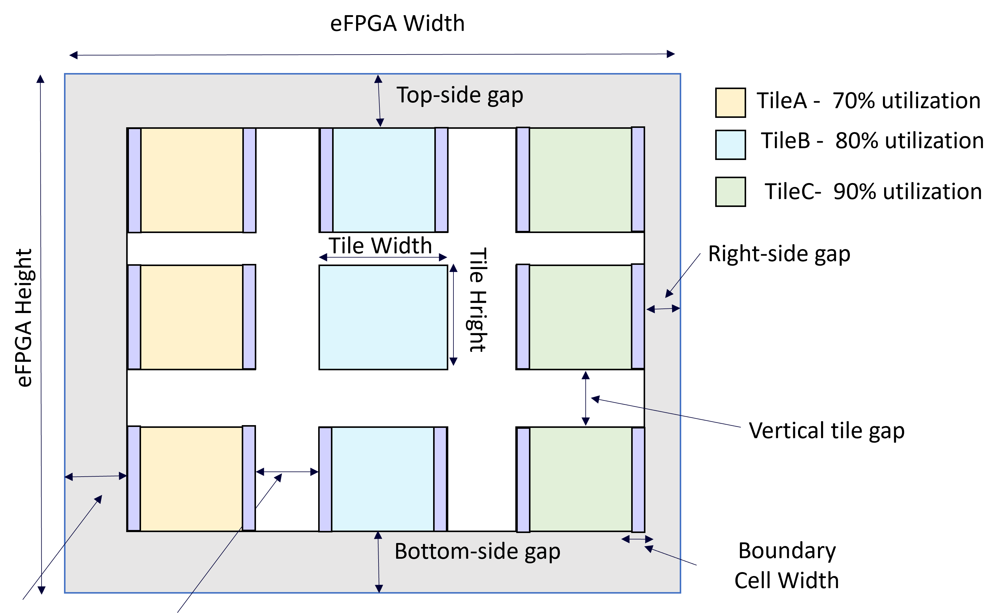

.. _file_format_floorplan_strategy_file:

Floorplan Strategy File (.xml)
==============================

The floorplan strategy file is designed to provide scalable and adaptive floorplanning methodology across different FPGA architectures and PDK.
The floorplan strategy file is loaded when creating or load a tapeout project (See details in :ref:`file_format_arch_template_file`)
:numref:`fig_floorplan_concepts` illustrates the critical concepts applicable to floorplanning, which will be detailed explained in this section.

.. _fig_floorplan_concepts:

   eFPGA floorplan concepts

An example of file is shown as follows.

.. literalinclude:: example_floorplan_strategy.xml
  :language: xml

.. _file_format_floorplan_strategy_file_reserved_words:

Reserved Words
--------------

The reserved words can be used in defining variables

.. option:: CPP

  The *Contact Poly Pitch* (CPP) defined in the standard cells of PDK configuration (see detailes in :ref:`file_format_pdk_file_stdcell`). 

.. note:: Only the CPP and heights of standard cell libraries which are used in the gate-level netlists will be considered. And all the used standard cell libraries have to be the same in CPP and heights.

.. option:: SC_HEIGHT

  The value of standard cell heights defined in the standard cells of PDK configuration (see detailes in :ref:`file_format_pdk_file_stdcell`)

General Settings
----------------

.. option:: boundary_cell_width="<string>"

  Define the minimum width per tile which should be reserved for boundary cells. Note that the width must be a multiply of ``CPP``. For example, ``CPP*4`` represents for a minimum width of four CPP should be reserved when sizing the dimension a tile.

.. option:: height_width_ratio="<float>"

  Define the ratio between height and width when sizing the dimension of a tile. For example, a ratio of ``1`` indicates that each tile will be sized in a square shape, while a ratio of ``0.5`` or ``2.0`` indicates that each tile will be sized in a rectangle shape. 

Tile Utilization
----------------

The utilization rate for each tile can be defined under the node ``tile_utilization``. 
A utilization rate denotes the percentage of cell area in the total area of a tile. 
For each tile, a specific utilization rate can be defined through the child node ``tile``

.. note:: A 100% utilization may not be achievable in practice. A typically range is between 70% and 95%, depending on the optmization techniques during physical design steps.

.. option:: default="<float>" 

  The default utilization rate applicable to all the tiles if not defined explicitedly. Must be in the range of (0, 1], where 0 represents 0% while 1 represents 100% 

.. option:: name="<string>"

  Specify the name of the tile where a custom utilization rate should be defined. Note that the tile name should match one of the tiles which can be checked through command ``report_module_names`` (See details in :ref:`arcxpress_project_commands_report_module_names`)

Tile gap
--------

Define the horizental and vertical gap between tiles under the node ``tile_gap``.  
The horizental gap should be under the child node ``horizental`` in the unit of ``CPP`` (See details in :ref:`file_format_floorplan_strategy_file_reserved_words`).
The vertical gap should be under the child node ``vertical`` in the unit of ``SC_HEIGHT`` (See details in :ref:`file_format_floorplan_strategy_file_reserved_words`).

Side gap
--------

Define the minimum gaps at the boundary of the eFPGA layout under the node ``side_gap``.
Four types of gaps are available to be customized

- ``top`` represents the gap at the top borderline of the eFPGA layout
- ``right`` represents the gap at the right borderline of the eFPGA layout
- ``bottom`` represents the gap at the bottom borderline of the eFPGA layout
- ``left`` represents the gap at the left borderline of the eFPGA layout

The ``left`` and ``right`` side gap should be in the unit of ``CPP`` (See details in :ref:`file_format_floorplan_strategy_file_reserved_words`).
The ``top`` and ``bottom`` gap should be in the unit of ``SC_HEIGHT`` (See details in :ref:`file_format_floorplan_strategy_file_reserved_words`).

Metal Stack
-----------

Define the detailed minimum dimension of each metal layer under the node ``metal_stack``.

.. note:: All dimension number are in the unit of [um]

For each metal layer, use a node of ``layer`` and define the following attributes: 

- ``name``: unique name of the metal layer
- ``length``: the minimum length of the metal fitting DRC rules when creating a terminal
- ``width``: the minimum width of the metal fitting DRC rules when creating a terminal
- ``spacing``: the minimum spacing between two metal pins fitting DRC rules

Signal Distribution Network
---------------------------

Global signals, such as clock and reset, as well as high-fanout signals requires detailed signal distribution network, so that they can be efficiently implemented by physical design tools.
The structure of the signal distribution network can profoundly impacts the latency, skew and transition time of the global signals..
Use the node ``signal_distribution_network`` to define details.

For each global signal requires a detailed network, a node ``network`` associated to its port at eFPGA top-level fabric is required.

- ``port``: the port name in Verilog format, e.g., ``clk[0]``, which must be a valid port at eFPGA top-level fabric
- ``type``: the type of signal distribution network structure. Currently, support ``htree`` and ``fishbone``.
- ``bufcell``: the name of buffer cell to be inserted when building a signal distribution network. Must be a valid cell in the standard cell library used in the eFPGA fabric.
- ``depth``: This is optional and only applicable when the type is ``htree``. The maximum levels of ``htree`` will be built w.r.t the given depth here. If not define, the maximum level will be automatically found. Note that ``depth=0`` indicates to find the maximum level automatically. 
 
For each network, the entry point of the global signal can be defined through node ``entry`` under its parent node ``network``

- ``x``: the x-axis coordinate 
- ``y``: the y-axis coordinate 

The (x, y) must be a validate coordinate within the eFPGA coordinate system (number of columns and rows for tiles)
